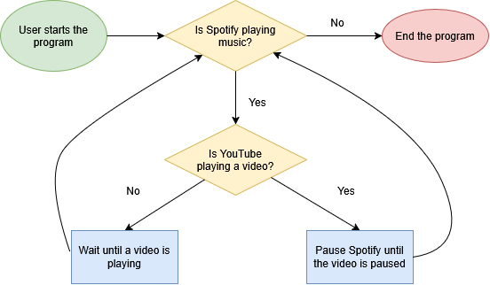

# Spotify Music Manager

Automatically pauses Spotify when a YouTube Video is playing.

## The Problem

I like to listen to music while working, but I also sometimes watch YouTube tutorial videos that I need to pause and unpause. So when watching a tutorial, either I have to not listen to music or constantly pause and unpause my music. 

## How It Works

A Java Program that tracks when Spotify is playing a song and when a YouTube video is playing, and either pauses/lowers the volume of Spotify when the video is playing.

## Tech Stack

- **Language:** Java
- **Libraries:** None
- **External tools:** Spotify Web API, YouTube Data API

## Setup

(TBA)

## Usage

(TBA)

## Roadmap

- Settings Menu where you can change the default volume of music
- Ability to pick whether you want to pause or lower the volume of your music
- Show the currently playing song

## Author

Sabrina Tang, https://github.com/cherryshrimp999
